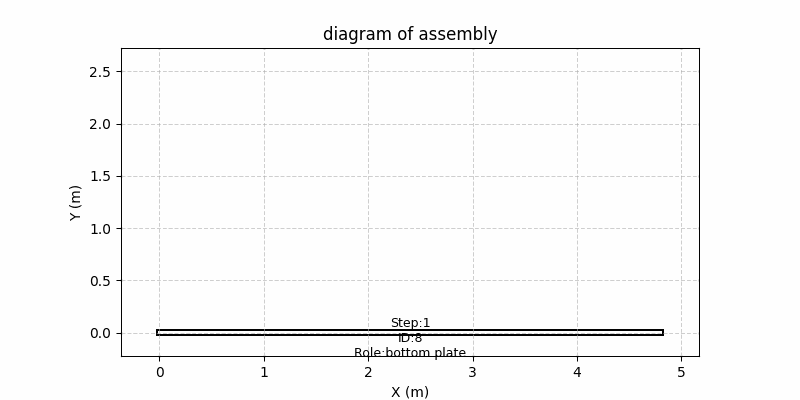
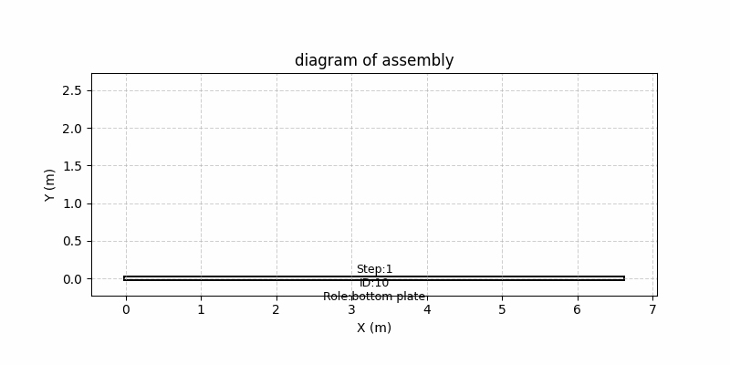

# LLM-Agent-assisted-Task-Sequencing-for-Robotic-Structural-Assembly

## Research Gaps
In conventional robotic structural assembly workflows, as illustrated in Fig. 1, robot engineers are required to manually extract structural geometric information from design models, plan assembly sequences, and program the robot accordingly. However, in construction-oriented structural assembly scenarios, structures often vary in size, geometry, and layout patterns. Even minor design changes require robot engineers to repeat the entire workflow of geometric interpretation, task sequencing, and robot programming. This strong reliance on manual intervention significantly reduces the level of automation and leads to low efficiency in robotic structural assembly applications. 

Figure 1. Conventional Workflow of Robotic Structural Assembly

In practical applications of robotic structural assembly, the final insertion of a component is typically executed by moving it from an approach position to its final target via a small linear translation. In this study, this translational vector is referred to as the slide-in direction.  As shown in Fig. 2(a), under a given assembly sequence, zero-clearance insertion of member 3 will lead to collision. Fig. 2(b) shows a different assembly sequence. This slide-in direction is safe and the corresponding assembly sequence is collision-free. A proper sequence plan and well-defined slide-in directions are essential for collision-free assembly. However, in previous studies on robotic structural assembly, slide-in direction planning has rarely been explicitly addressed, and safe slide-in direction has not been incorporated as a critical constraint in collision-free assembly sequence planning.

Figure 2. Illustration of zero clearance insertion under inproper sequence (a) and safe slide-in direction under proper sequence (b)

## Proposed LLM-driven Task Sequencing Method for Robotic Structural Assembly

To address the aforementioned problems in robotic structural assembly, we proposed an LLM-driven task sequencing method for robotic structural assembly. As shown in Fig. 3, the proposed approach constructs LLM agents that take structured geometric information extracted from BIM design models as input and generate assembly sequence plans as output. 

Figure 3. Proposed Workflow of LLM-assisted Robotic Structural Assembly

The technical pipeline of the proposed method is shown in Fig. 4. This pipeline is an automated workflow designed to transform structural design models into robot-executable assembly sequence plans. 

Figure 4. Technical Pipeline of the proposed LLM-driven Task Sequencing Method for Robotic Structural Assembly

A generator-corrector architecture is adopted to improve reasoning reliability. As illustrated in Fig. 5, the proposed agent architecture consists of two core modules: a Generator and a Corrector. The agent has abilities to identify structural component roles, determine assembly sequences, and infer feasible slide-in directions. 

In this study, we developed customized prompts for the Generator and Corrector modules. The Generator focuses on identifying member roles, defining assembly sequence rules, and producing a preliminary assembly sequence plan. In contrast, the Corrector emphasizes error checking, sequence repair, and additionally determines the slide-in direction for each structural member.

The LLM Agent is powered by OpenAI ChatGPT-o3 model via Responses API (standard processing tier), with the default temperature setting (1.0) and high reasoning effort enabled. 

Figure 5. Generator-Corrector Architecture of the LLM Agent

Timber structural models were built using Autodesk Revit 2025, including six wall-frame models. The complexity of the wall frame structures increased by enlarging structure dimensions, increasing the number of members, and introducing door-opening and window-opening. Fig. 6 shows the examples of wall 3 and wall 6.

  

Figure 6. Examples of design revit model wall 3 (left) and wall 6 (right)

Figure X. Example of Geometry Information in JSON Format

Figure X. Example of **Generator Output** of Reasoning Process in TXT Format

Figure X. Example of **Generator Output** of Sequence in JSON Format

Figure X. Example of **Corrector Output** of Reasoning Process in TXT Format

Figure X. Example of **Corrector Output** of Sequence in JSON Format

  

Figure X. GIF Animations of a Success Case (left) and a Failure Case (right) of Wall 3

  

Figure X. GIF Animations of a Success Case (left) and a Failure Case (right) of Wall 6

